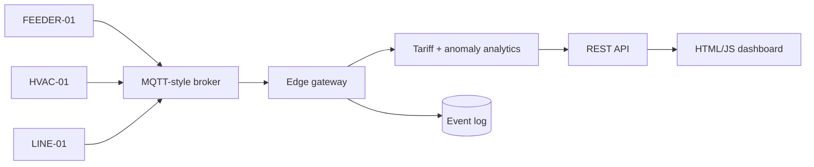

# Architecture

## Components

- `energy_meter.py`: deterministic load model with shift profile and random jitter.
- `mqtt_broker.py`: topic pub/sub, retained last value and message counters.
- `analytics.py`: tariff lookup, energy/cost accumulation and anomaly rules.
- `energy_gateway.py`: orchestrates sampling, publishing and analysis.
- `energy_server.py`: REST API plus static HMI.

## Timing

- Simulation tick: 1 s.
- Meter sample interval: 1 s.
- Analytics summary: computed from the retained event history on every API read.

## Boundary

This project is a software simulation. It does not implement real MQTT networking, TLS, device authentication, PLC polling or billing-grade metering.
